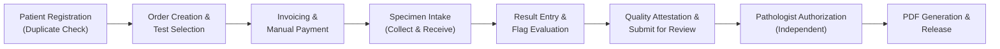

# Staff Operating Guide: Daily Clinical & Administrative Procedures

## 1. Role Types & Operational Boundaries

| Role | Permitted Responsibilities | Restrictions & Prohibitions |
| :--- | :--- | :--- |
| **Admin** | Laboratory configuration, staff management, reviewer scopes, catalogue, billing, discounts, issuing refunds, expenses, and full financial reconciliation. | **Cannot clinically authorize reports** unless holding a separate active Authorized Reviewer credential AND did not enter the results. |
| **Lab Staff** | Search/register patients, create orders, collect/receive specimens, enter draft results, log critical notifications, attest QC checks, submit for review, collect payments up to discount limit. | Cannot authorize reports, manage staff, issue refunds, or access aggregate financial summaries. |
| **Authorized Reviewer** | Inspect clinical review queue, return submissions for correction, clinically authorize reports within verified scope, release reports, and authorize amendments. | Cannot authorize results they entered or clinically edited (Independent Review Invariant). No staff administration or refund rights. |

---

## 2. Daily Standard Operating Procedure (SOP)

### Step 1: Patient Search & Registration
1. Always search first by patient name, phone number, or patient ID before creating a record.
2. If potential duplicate warnings appear, verify with the patient. **Never duplicate records.**
3. Store Date of Birth when known; if DOB is unknown, check "DOB unknown" and record the estimated age explicitly.

### Step 2: Order & Invoicing
1. Select the patient and click **+ Order Tests**.
2. Select required tests from the active catalogue.
3. Review auto-calculated subtotal. Lab Staff may apply discounts up to the laboratory's maximum configured limit (e.g. 15%). Admin discounts are unrestricted.
4. Confirm order to generate the unique order number (`ORD-YYYY-XXXX`) and invoice (`INV-YYYY-XXXX`).

### Step 3: Specimen Intake (Collect & Receive)
1. For on-site phlebotomy, click **Collect & Receive** to set both timestamps and record the staff actor in a single step.
2. If a specimen is hemolyzed, clotted, or insufficient (QNS), click **Reject & Recollect**.
3. Enter a mandatory clinical reason. The system automatically marks the specimen rejected and generates a linked replacement specimen (`awaiting_collection`).

### Step 4: Result Entry & Quality Attestation
1. Open the order in **Tests & Results**.
2. Enter numeric, qualitative, or text values. Distinguish `0.0` from unperformed tests.
3. If a test was not performed, select `Not Performed` and record a mandatory disposition reason.
4. If a value falls outside critical limits, a red `CRITICAL` badge appears:
   - Click **Log Critical Alert**.
   - Contact the ordering physician or clinical triage nurse by telephone.
   - Obtain and document explicit verbatim read-back confirmation.
5. Click **Submit for Review**. Complete the mandatory **Quality Check Attestation** confirming calibration and control limits.

### Step 5: Clinical Authorization & Release
1. The Authorized Reviewer navigates to **Reports** > **Review Queue**.
2. Review patient history, specimen condition, result values, reference ranges, and critical communications.
3. **Independent Authorization Rule**: A reviewer cannot authorize any order where they entered or edited draft results.
4. Click **Authorize & Release**. The system executes a database transaction that compiles an immutable JSON report snapshot, creates the server-rendered A4 PDF, and marks the report released.
5. Download or print the finalized clinical PDF.

### Step 6: Handling Corrections & Amendments
- If errors are discovered during review: click **Return for Correction** with a detailed note.
- If errors are discovered after release: click **Amend**. Enter a clinical reason and record communication of material correction to the ordering physician. This marks the earlier version `SUPERSEDED` and issues a new version number (e.g. `v2`).
